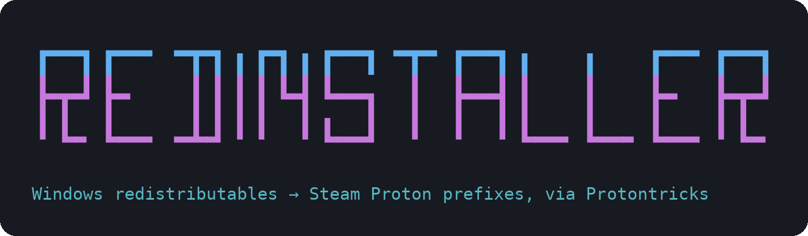

# Redinstaller

<p align="center"></p>

A terminal tool for Linux that installs a game's Windows redistributables
(the `.exe` / `.msi` files in `_CommonRedist`: VC++ runtimes, DirectX, .NET,
OpenAL, …) into its Steam Proton prefix with
[Protontricks](https://github.com/Matoking/protontricks). It works with Steam
games and non-Steam shortcuts.

It comes as a terminal command (`redinstaller`, a single bash script) and a
desktop app (`redinstaller-gui`, GTK 4) that does the same steps in a window.
Both share the same settings. It works on Arch, Debian, Ubuntu, Fedora and their
derivatives, plus SteamOS and other immutable distros through Flatpak
Protontricks. If something is missing, it detects your distro and prints the
right install command.

## Features

- **Game picker:** lists every non-Steam shortcut (games you added to Steam
  yourself) that has a Proton prefix; regular Steam games aren't shown. Listed as `Name  |  AppID`,
  searchable with [fzf](https://github.com/junegunn/fzf) (or a numbered menu
  without it).
- **Finds the redist folder for you.** It locates the game's install folder
  (from the Steam app manifest, or `shortcuts.vdf` for non-Steam games) and
  searches it for `_CommonRedist`, `Redist`, `Installers`, `DirectX`,
  `vcredist`, … For non-Steam games it also searches up to 4 parent folders,
  stopping below your home folder. You can also browse the game folder
  (with a preview of the installers in each folder) or type any path.
- **Installs `.exe` and `.msi` files** one at a time, with a progress bar, the
  installer's output, and a summary at the end.
  - `.exe`: `protontricks-launch --appid <APPID> <file>`
  - `.msi`: `protontricks -c 'wine msiexec /i <file>' <APPID>`
- **Silent mode (optional):** adds quiet flags for known installers (VC++,
  DirectX, .NET, OpenAL, any `.msi`).
- **Treats "already installed" / "reboot requested" exit codes**
  (1638, 3010, 1641) as success.
- **Ctrl+C skips** the running installer and asks whether to continue.
- **Steam launch options (optional):** writes launch options for the game,
  by default:
  ```
  WINEDLLOVERRIDES="OnlineFix64,SteamOverlay64,winmm,dnet,steam_api64=n,b" %command%
  ```
  It merges with what's already there (keeping your other options) unless
  you choose replace. See [Launch options](#launch-options).
- **Native or Flatpak Protontricks**, detected automatically.
- **`--dry-run`** shows every command without running anything.
- **Settings screen** (`redinstaller --config`) to pick your defaults:
  silent installs, auto-picking the redist folder, launch options and more.

## Desktop app

`redinstaller-gui` (or **Redinstaller** in your app menu) does everything the
terminal version does, in a window:

1. **Games:** a searchable list of every non-Steam game with a Proton prefix.
2. **Folder:** the detected `_CommonRedist`-style folders with their installer
   counts, a folder picker for browsing, or a box to type any path.
3. **Review:** the files that will be installed and their silent flags, with
   switches for silent mode and dry run, plus the Steam launch options
   (merge or replace, with a preview of the old and new value).
4. **Install:** a progress bar, the installer output, a **Skip this
   installer** button (like Ctrl+C), and a summary at the end.

Settings (Ctrl+,), the first-run questions, closing Steam for launch options
and uninstalling all work as they do in the terminal. It reads and writes the
same `~/.config/redinstaller/config`, and takes the same command-line options
(`--appid`, `--dry-run`, `--silent`, `FOLDER`, …; see
`redinstaller-gui --help`).

It needs Python 3 with PyGObject, GTK 4.10+ and libadwaita 1.5+ (the quick
installer sets these up). It doesn't need `fzf` or `perl`.

| Distro | Packages |
|---|---|
| Arch | `sudo pacman -S python-gobject gtk4 libadwaita` |
| Fedora | `sudo dnf install python3-gobject gtk4 libadwaita` |
| Debian 13, Ubuntu 24.04+ | `sudo apt install python3-gi gir1.2-gtk-4.0 gir1.2-adw-1` |

## Install

### Quick install (any distro)

```bash
curl -fsSL https://raw.githubusercontent.com/Jecobe/redinstaller/main/install.sh | bash
```

The installer detects your distro, installs Protontricks, `fzf`, `perl` and
the desktop app's GTK libraries with your package manager (it asks first),
puts the `redinstaller` and `redinstaller-gui` commands in `/usr/local/bin`,
and adds Redinstaller to your app menu. On SteamOS, Bazzite and other immutable distros
it uses Flatpak Protontricks and installs to `~/.local/bin`. Want to read it
first? [install.sh](install.sh)

#### Installer options (optional)

Most people don't need these; the command above works on its own.

To change how the installer behaves, add `-s --` after `bash`, then the
options you want. For example, to install just for your user (into
`~/.local/bin`) instead of system-wide:

```bash
curl -fsSL https://raw.githubusercontent.com/Jecobe/redinstaller/main/install.sh | bash -s -- --user
```

`-s --` tells bash "the options after this are for the installer, not for
bash itself". Without it, bash would try to use `--user` itself and fail.
You can list several options, e.g. `bash -s -- --user --yes`.

| Option | Effect |
|---|---|
| `--user` | Install to `~/.local/bin` (no root for the script itself) |
| `--no-deps` | Only install the scripts |
| `--no-gui` | Skip the desktop app and its dependencies |
| `--flatpak` | Use Flatpak Protontricks on any distro |
| `--ref TAG` | Install a specific version, e.g. `--ref v1.0.0` |
| `-y`, `--yes` | Don't ask before installing packages |
| `--uninstall` | Remove the `redinstaller` and `redinstaller-gui` commands |

The sections below are for installing by hand.

### Any distro

Install the dependencies (below), then put the script on your `PATH`:

```bash
git clone https://github.com/Jecobe/redinstaller.git
sudo install -Dm755 redinstaller/redinstaller /usr/local/bin/redinstaller
# optional: the desktop app and its menu entry
sudo install -Dm755 redinstaller/redinstaller-gui /usr/local/bin/redinstaller-gui
sudo install -Dm644 redinstaller/data/io.github.Jecobe.Redinstaller.desktop \
  /usr/local/share/applications/io.github.Jecobe.Redinstaller.desktop
```

Or, without root: `install -Dm755 redinstaller/redinstaller ~/.local/bin/redinstaller`
(make sure `~/.local/bin` is on your `PATH`).

#### Arch Linux (and Manjaro, EndeavourOS, CachyOS)

```bash
sudo pacman -S protontricks fzf perl
```

#### Fedora (and Nobara)

```bash
sudo dnf install protontricks fzf perl-interpreter
```

#### Ubuntu, Linux Mint, Pop!_OS

Protontricks is in the `multiverse` component:

```bash
sudo add-apt-repository multiverse
sudo apt install protontricks fzf
```

#### Debian

Protontricks isn't packaged in Debian 13 (stable). Install it with `pipx`;
it also needs `winetricks`, which is in the `contrib` component (enable it in
your APT sources first):

```bash
sudo apt install pipx winetricks fzf
pipx install protontricks
pipx ensurepath              # puts protontricks on your PATH (log out and back in)
```

If Steam came from Debian's or Ubuntu's `steam` package, it lives in
`~/.steam/debian-installation`. Redinstaller checks there automatically.

#### SteamOS (Steam Deck), Bazzite, Fedora Silverblue

Use the Flatpak version of Protontricks, and install the script to
`~/.local/bin` (see above):

```bash
flatpak install flathub com.github.Matoking.protontricks
```

`fzf` is optional; without it you get numbered menus.

The game must have been launched once with Proton so its prefix exists.

## Usage

```bash
redinstaller
```

1. Pick the game.
2. Pick a detected redist folder, browse, or type a path.
3. Review what will be installed (optionally set launch options).
4. Install.

### Options

| Option | Effect |
|---|---|
| `FOLDER` | Redist folder to use (skips the folder step) |
| `--config` | Open the settings screen (see [Settings](#settings)) |
| `--appid ID` | Preselect a game |
| `--recursive` / `--no-recursive` | Include installers in sub-folders, or don't |
| `--silent` / `--no-silent` | Use quiet flags for known installers, or don't |
| `--flatpak` / `--native` | Force a Protontricks flavour |
| `--verbose` | Keep Wine debug output (`WINEDEBUG` isn't silenced) |
| `--dry-run` | Print commands, run nothing |
| `-y`, `--yes` | Don't ask "Install N file(s)?" |
| `--launch-options[=OPTS]` | Also set the game's Steam launch options |
| `--replace-launch-options` | Replace existing launch options instead of merging |
| `--no-launch-options` | Don't set launch options this time |
| `--no-config` | Ignore your settings for this run |
| `--uninstall` | Remove Redinstaller (see [Uninstall](#uninstall)) |
| `--version` | Print the version |
| `-h`, `--help` | Show help |

## Settings

The first time you run `redinstaller`, it asks four quick questions (silent
installs, which Protontricks to use, Steam launch options, and whether to
auto-pick the found redist folder) and saves your answers.

Run `redinstaller --config` at any time to change those and everything else.
Use the arrow keys (or type to search), press Enter to change the highlighted
setting, and Esc when you're done. Changes are saved straight away.

| Setting | Default | What it does |
|---|---|---|
| Silent installs | off | Quiet flags for VC++, DirectX, .NET, OpenAL and `.msi` installers |
| Search sub-folders | off | Include sub-folders of a folder you type in |
| Auto-pick found folder | off | Use the detected `_CommonRedist` folder without showing the menu |
| Levels to search up | 4 | Parent folders to search above a non-Steam game (0-10) |
| Confirm before install | on | Ask "Install N file(s)?" first |
| Set launch options | ask | Write Steam launch options: ask, always or never |
| Launch options | `WINEDLLOVERRIDES=…` | The launch options to write |
| Existing launch options | ask | merge, replace, or ask each time |
| Close Steam | ask | Offer to close Steam for launch options, or never (skip them) |
| Protontricks | auto | auto, native or flatpak |
| Wine debug output | off | Show Wine's debug messages |
| Steam folder | auto | Only if Steam isn't found automatically |
| Show logo | on | Show the logo at start-up |

Settings are stored in `~/.config/redinstaller/config`, a plain text file you
can also edit by hand (each setting has a comment explaining it). Options on
the command line override your settings for that run, e.g. `--no-silent`.

For a fully hands-off run, turn on **Silent installs** and **Auto-pick found
folder**, and turn off **Confirm before install**; then
`redinstaller --appid <ID>` installs everything without a single question.

## Launch options

- **Steam games:** written to `userdata/<account>/config/localconfig.vdf` for
  the logged-in account.
- **Non-Steam shortcuts:** written to the shortcut's entry in
  `userdata/*/config/shortcuts.vdf`.

Before writing, the original file is copied to
`<file>.redinstaller-<timestamp>.bak`. Only the `LaunchOptions` value is
changed; everything else in the file stays byte-for-byte the same. This step
needs `perl`; without it, Redinstaller prints the options for you to paste
into Steam → Properties → Launch Options.

Merging keeps your existing options and puts the new environment variables in
front, replacing any variable with the same name:

| Existing | Result |
|---|---|
| *(none)* | `WINEDLLOVERRIDES="…" %command%` |
| `gamemoderun %command%` | `WINEDLLOVERRIDES="…" gamemoderun %command%` |
| `-vulkan` | `WINEDLLOVERRIDES="…" %command% -vulkan` |
| `WINEDLLOVERRIDES="old" %command%` | `WINEDLLOVERRIDES="…" %command%` |

**Steam has to be closed.** Steam rewrites these files when it exits, so a
change made while it's running would be lost. If Steam is running, Redinstaller
asks whether to close it (`steam -shutdown`, which also closes any game
running through Steam) or skip this step. It never closes Steam without
asking. To undo a change, restore the `.bak` file while Steam is closed.

## Uninstall

```bash
redinstaller --uninstall
```

It shows what it will remove and asks first. The desktop app can do the same
from its menu (**Uninstall Redinstaller…**). Both remove the terminal command,
the desktop app and its menu entry. A copy installed by the quick
installer or by hand is deleted; a copy from a package is
removed with your package manager. It
then asks whether to delete your settings too. Protontricks, fzf, perl and
any Steam config backups (`*.redinstaller-*.bak`) are left in place.

## Troubleshooting

- **"Protontricks was not found":** install it (see above), or pass
  `--flatpak` / `--native`.
- **Game missing from the list:** only non-Steam shortcuts are listed. Add
  the game to Steam (Games → Add a Non-Steam Game), launch it once with Proton (Properties →
  Compatibility), then run Redinstaller again.
- **Flatpak: installer "not found":** the sandbox can't see the folder. Run
  the `flatpak override` command Redinstaller prints, or:
  `flatpak override --user --filesystem=/path/to/folder:ro com.github.Matoking.protontricks`.
- **An installer fails:** rerun with `--verbose`, or try it by hand:
  `protontricks-launch --appid <APPID> /path/to/file.exe`.
- **Steam can't be found:** set `STEAM_DIR=/path/to/Steam`.

## License

[GPL-3.0-or-later](LICENSE)
